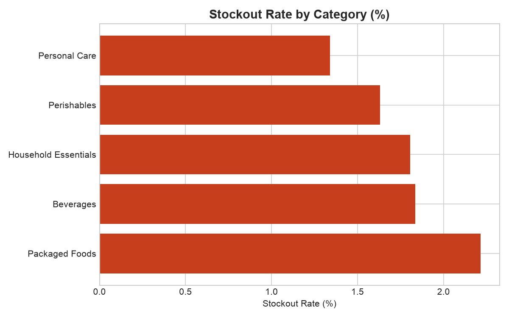
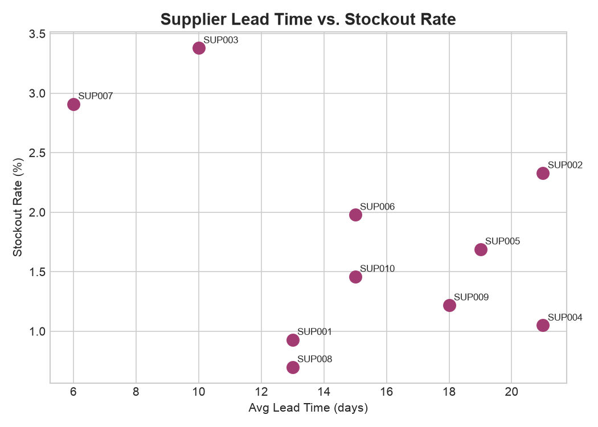
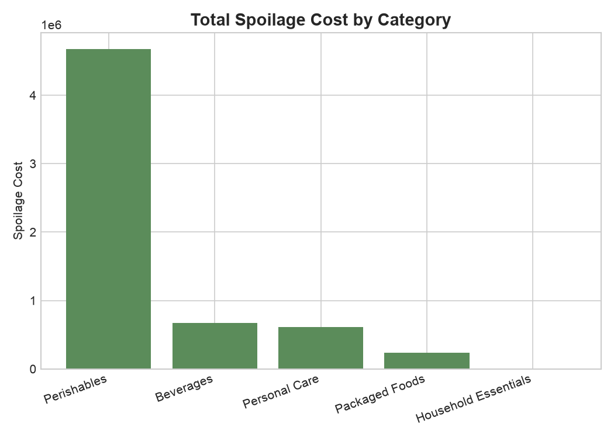
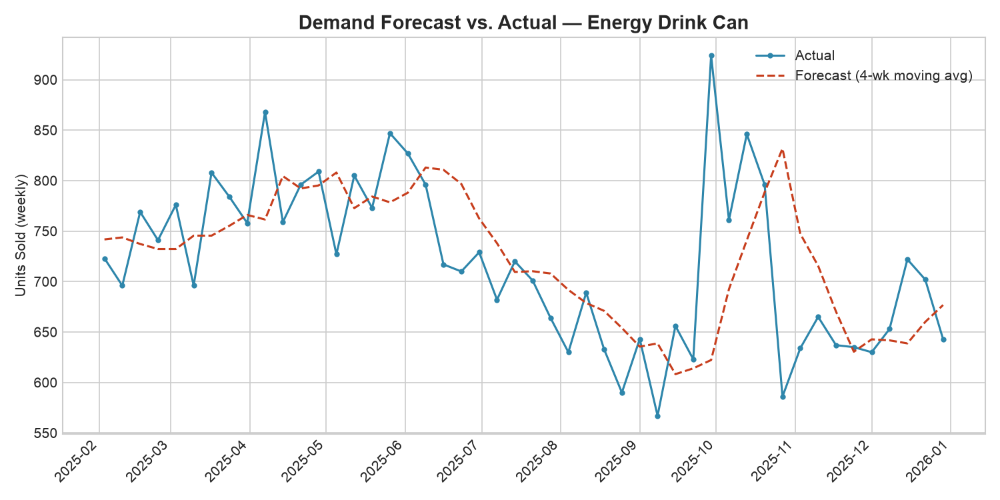

# Retail Supply Chain Analytics
### Inventory performance · Supplier risk · Demand forecasting · Power BI

An exploratory analytics case study of inventory availability, supplier reliability, and spoilage across a simulated multi-region retail operation. The repository combines a Python analysis workflow, SQL queries, Power BI assets, and documented operational recommendations.

> **Project provenance:** This repository is an adaptation/study copy of [DataWithSoumya/retail-supply-chain-analytics](https://github.com/DataWithSoumya/retail-supply-chain-analytics). The source code, supplied data, report assets, and original analytical approach originated there. My work so far has been to set up the project on macOS, run the analysis, reproduce its outputs, and review the results. The work should not be interpreted as an independently designed dashboard or pipeline. Redistribution permissions for the upstream assets have not yet been verified.

## The analytical question

A high overall in-stock rate can hide expensive local failures. Which products and regions experience stockouts? Are delays or supplier reliability more closely associated with those gaps? How much stock is lost to spoilage, and could a straightforward demand estimate help inform replenishment?

The supplied synthetic data represents weekly inventory observations for **16 stores, 30 products, and 10 suppliers**, grouped across four regions and five product categories.

## What's in the repository?

| Component | Location | Purpose |
| --- | --- | --- |
| Python analysis | `analysis.py` | Clean weekly records, derive KPIs, compare categories and suppliers, and evaluate a moving-average forecast |
| Raw and processed datasets | `data/` | Source ledger, lookup tables, cleaned ledger, flat Power BI dataset, and KPI summary |
| SQL analysis | `sql/schema_and_queries.sql` | Schema and business-oriented analytical queries |
| Power BI report | `retail-supply-chain-dashboard.pbix` | Report file supplied by the upstream project; not independently authored here |
| Power BI documentation | `powerbi/POWER_BI_GUIDE.md` | DAX measures and suggested report-page structure |
| Exploratory charts | `images/` | Category, region, supplier, spoilage, and forecasting visuals |
| Recommendations | `SUPPLY_CHAIN_RECOMMENDATIONS.md` | Operational interpretation of the supplied analysis |

## Reproducing the Python analysis

From the project directory:

```bash
python3 -m venv .venv
source .venv/bin/activate
python -m pip install pandas numpy matplotlib
python analysis.py
```

The script writes `data/inventory_ledger_clean.csv`, `data/powerbi_dataset.csv`, `data/summary_metrics.csv`, and charts under `images/`.

**Local reproduction (14 November 2026):** the run processed 17,417 raw ledger rows, removed 257 duplicates, and generated the expected cleaned datasets and figures.

## Findings reproduced in the local run

| Indicator | Result |
| --- | ---: |
| Overall fill rate | 98.2% |
| Stockout rate | 1.8% |
| Estimated lost sales value | 2,123,038 |
| Total spoilage cost | 6,199,272 |
| Highest category stockout rate | Packaged Foods — 2.2% |
| Forecast example | Energy Drink Can, 4-week moving average |
| Forecast MAPE | 7.2% |

*The source output does not establish a currency, so cost figures are shown without currency symbols. All figures are based on synthetic data and are not real retailer performance.*

### Where availability breaks down



The headline fill rate is high, but Packaged Foods reports the highest category stockout rate. That suggests reviewing category-level replenishment settings rather than relying only on an aggregate service KPI.

### Supplier performance



Supplier-level correlations in this sample were **−0.45** for lead time versus stockout rate and **−0.44** for reliability versus stockout rate. These are associations in generated data—not evidence that one variable causes stockouts. Differences in reorder policies and supplier assignment may affect both relationships.

### The spoilage trade-off



Perishables account for most of the simulated spoilage cost. A sensible next analysis would compare smaller, more frequent orders against the resulting service-level and procurement-cost trade-offs.

### A lightweight forecast baseline



The four-week moving-average example achieved **7.2% MAPE** on one product. This is a useful baseline, but not proof that the same performance holds across all SKUs or seasons.

## Power BI report

The repository contains the upstream `.pbix` and a build guide describing an Executive Overview, Supplier Scorecard, and Inventory Health page. See [the Power BI guide](powerbi/POWER_BI_GUIDE.md) for measures and field mappings.

Power BI Desktop does not run natively on macOS. A supported Windows environment or an eligible Power BI Service account is needed to edit or publish the PBIX. **A publicly hosted report link is not available for this repository yet.**

## Areas to improve

The most useful original contributions would be to:

1. Model the supplier, store, product, and inventory tables as a documented star schema and verify filter behavior.
2. Test how fill rate, stockout rate, and turnover definitions behave under different aggregation levels.
3. Compare a four-week moving average with seasonal naïve and other baseline forecasts on multiple products using time-based validation.
4. Add supplier risk segmentation, forecast error analysis, and actionable replenishment scenarios.
5. Rebuild and publish an original Power BI report with documented changes and permission to use all included assets.

## Source and usage notes

- **Upstream author/project:** [DataWithSoumya — retail-supply-chain-analytics](https://github.com/DataWithSoumya/retail-supply-chain-analytics)
- **Data:** Synthetic demonstration dataset; not operational or confidential company data.
- **Attribution:** The original project provides the datasets, analysis implementation, SQL, Power BI materials, and primary findings. Running it locally does not transfer authorship.
- **Licensing:** No top-level license was identified in the upstream file listing. Public visibility alone does not grant redistribution rights. Permission for rehosting the upstream materials should be clarified before treating this repository as a distributable project.

This repository currently documents a **reproduced learning case study**. Any future independently implemented changes should be recorded explicitly in the commit history and this README.
